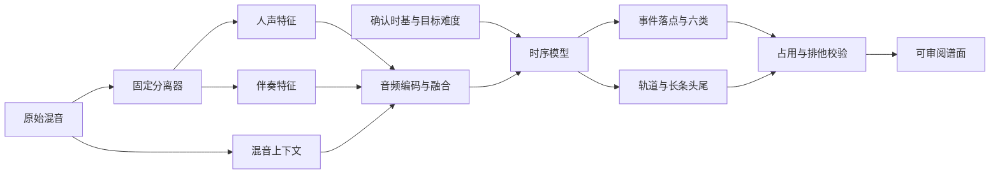

# 训练前实施规划

**后续执行更新：** 用户已授权按本计划完成训练前准备，监督训练由Sol接手。实际实现见[15号契约](15-联合制谱模型与训练数据契约.md)，最终产物与未完成项见[16号交接](16-Sol监督训练交接.md)。本轮交付独立六类表示／导出校验及审阅页面；完整生产编辑器接线、真人听评与真实游戏验收仍未完成，不把原计划所有验收项一概标DONE。以下为原规划快照。

2026-09-27。状态：规划草案，尚未领取实施任务。用户要求“先规划”；本轮只整理计划，不启动训练、全库分轨、特征缓存或标签批量转换。本文细化 X004-b 的后续顺序，不替代12/13文档的业务规则，也不把现有提案视为已批准架构。

## 1. 当前起点

数据复制、解压和范围重筛已完成：8.5～10.5（含两端）共346张谱，338份不同规范音频，336个临时作品族；音频全部核验通过，135张等级来源不一致。仍未冻结训练／验证／测试切分。

学习类别已确定为轻击、重击、特重击、Gemini、长条、齿轮。突袭／倒置突袭与Note归轻击；Ghost排除，其他道具暂排除；普通连打击打部分简化为起点双重击、实际长按另行保留；Boss连打持续段转双轨长条；Boss单次非连击近身攻击归排他特重击。

当前只有原始BMS格点和来源盘点，尚无通过语义／时间复核的TrainingChart。现有ChartIR和basic导出只支持部分物件；已有分轨引擎能够本地运行，但实曲分离质量和生产选型尚未完成。网络尚未实现或训练。

## 2. 串行实施顺序与交付

以下P编号仅为本规划的步骤编号，均未开始；实际领取时再按施工日志要求拆成拥有明确修改范围和验收证据的工作包。

| 顺序 | 工作 | 交付物 | 完成依据 |
|---|---|---|---|
| P01 | 收敛物件、时间和占用契约 | 归并规则v3、SourceChart/TrainingChart字段草案、未决项表及实例 | 每种物件的时间、轨道、头尾、排他／占用含义明确；已确定与待审查规则分开 |
| P02 | 小样本还原原谱并预览归并 | 完整语义／时间解析的最小实现、覆盖特殊对象的样例集、归并前后对照 | 能按音频原点核对落点和长条头尾；每个变化可追溯，未知与冲突可见，不以原始标记数冒充事件数 |
| P03 | 确认首版训练架构与资源预算 | 输入输出、网络、监督／损失、约束、采样和评估配置说明 | 输入来源与推理一致；同刻多物件和持续占用可表达；无来源标签泄漏；用户架构确认有记录 |
| P04 | 全量生成候选训练标签并清理数据 | 版本化TrainingChart、质量报告、等级／未知对象／冲突清单、作品族与切分清单 | 所有346张都有明确处理结果；可用量与排除原因真实可查，同曲同族不跨角色，未解决问题不混作合法标签 |
| P05 | 验证分轨与制作特征 | 代表片段分离对照、确定的分离／特征配置、对齐检查和可恢复缓存 | 人声／伴奏／混音时间原点和长度一致，漏音／长音／静音行为可审阅，配置和版本可追溯 |
| P06 | 接通六类表示与训练前整链检查 | 必要的ChartIR／校验／预览／导出扩展，数据加载与模型前向检查报告 | 六类、双轨长条、特重击排他可表示且冲突可见；旧工程仍可读；数据批次、mask、前向输出和资源检查通过 |

P01～P02优先解决标签事实，P03确定架构；P04以后使用已确认的契约执行全量工作。P05内部先进行小样本分轨审阅和资源测量，通过后再生成全量缓存。P06不执行反向传播或优化器更新，不产生训练checkpoint。

实现只扩展已有代码所缺的部分。现有保守BMS读写器不能直接当作全社区谱解析器；现有作品族清单／数据隔离机制、分轨适配器和不可变产物机制优先复用，不重新复制同类基础设施。

## 3. P01需要收敛的业务边界

| 项目 | 当前已知 | 下一步处理 |
|---|---|---|
| 普通连打的双重击 | 起点双重击已确定；地空各一击是草案解释 | 用真实谱例核对两个事件及其与长条起点的关系，明确重叠时可玩性规则 |
| 特重击排他 | 排他属性已确定；同刻双轨为草案解释 | 明确排他作用域、同刻容差、前后是否留空，以及与长条尾点相接的边界；未确定前不硬编码时间窗口 |
| 其余轻／重击归并 |13表部分行仍为建议 | 展示原对象和归并结果后确定，不能把用户仅修正两行视为批准全部建议 |
| 长条与连打 | 保留真实区间，不造尾点 | 核验长按通道、点按形式和真实头尾配对，区分Boss近身单击与连打 |
| 未知代码／时基 | 原始数据已保留 | 固定目标加载器语义来源；仅解释有证据的功能，不支持项保留审查／mask原因 |

这些问题先整理成有限的真实实例供审阅，避免连续抛出抽象问题。源码可查明的事实自行核验；创作偏好才需要用户决定。

P02建议先选10～20个有代表性的短片段，覆盖六类、普通连打两种形式、Boss单击／连打、音符／幽灵／道具、变速／变小节、音乐偏移及占用冲突。数量以覆盖为准，不能把“片段数足够”当成语义已经正确。这些审阅片段用于开发，所属作品族后续不得进入锁定测试集。

## 4. P03拟讨论的架构

当前建议保持分任务路线：

讨论并确定：

- 人声／伴奏分支是否共享编码器参数，混音上下文如何融合；时序网络在小型TCN／Transformer等候选中选一种首轮实现，结合本机实际算力与窗口长度决定容量。
- 输出必须能表达同刻多物件、普通连打的双重击、长条＋击打及双轨长条；不能以“每个时刻六选一”的全局单标签输出丢掉合法并发。特重击作为独立类别，排他约束覆盖其作用域。
- 事件存在、类别、轨道、头尾与ignore/mask的定义；齿轮与击打选点分开评价，特重击稀少时报告有效数量并制定训练集内的采样／损失权重策略。
- 时间分辨率、窗口和上下文、跨窗长条边界、难度小数输入、特征维度，以及训练与实际生成共同遵守的音频原点。
- 人声优先体现为可解释的声部选择／融合偏好：清晰人声音核优先，空隙与间奏由伴奏接续；人声仍有音量不等于继续出note。社区谱没有声部归属标注，单靠双分支不能宣称已学会这种偏好，需要开发／训练族片段上的声部参考或明确的选择策略。

先给出一份具体、可估算资源的架构v1供确认，再实施全量输入缓存和训练入口；不把上述所有候选同时做成生产实现。

## 5. P04～P06的质量检查

135张等级来源冲突按既定来源优先级逐类核验，保留难度依据；尚不能确定的行单独列出，不默认全部剔除，也不混成已审查。作品族复核应涵盖重编码、同曲多谱及可识别的翻唱／重混；338个PCM身份和336个临时家族不是最终独立歌曲数。

建议按作品族约80/10/10分配训练／验证／锁定测试，比例仍待P03确认。先决定整曲／作品族角色，再切窗口；参与映射、分轨选型、架构和误差调试的片段所属族不得进入锁定测试。冻结后测试集不参与权重／阈值／结构调参。社区参考仍是社区监督，不能冒充独立人工gold。

特征缓存应记录音频、分离模型、特征配置和标签版本身份，支持中断恢复、坏缓存检测与重算；不能因缓存文件存在就视为结果有效。分离模型比较沿用既有T045-c2/T049-d范围，不以混音重建一致证明人声分离质量。

P06至少检查：各类有效样本量、长条起止与跨窗规则、排他冲突、未知／排除覆盖、数据泄漏、加载顺序可复现、空白段和有效标签mask、模型前向形状／有限数值及峰值内存。导出扩展使用独立版本/profile，回读不能把特重击丢成普通tap。真实游戏加载与真人游玩另列验收，不把程序回读成功当作实玩通过。

## 6. 训练启动之后的阶段（当前不执行）

完成上述准备并取得用户启动训练的指令后：先仅在训练角色内取少量样本验证收敛、checkpoint、恢复和取消，再训练首版模型。按落点、类别、轨道、长条头尾、密度／休息、特重击排他与人声优先片段表现分别报告，并与规则基线比较；模型验证指标与真人采音／手感评价分开。

达成可审阅结果后再接入生成工作流和后处理风格选择，模型先作为候选，不自动替换生产默认方案。幽灵补拍和音符表现需遵守排他与长条占用，并依据用户另行确定的后处理规则实现。

## 7. 下次工作的第一份交付

建议从P01开始，交付 **六类事件字段＋排他／占用边界表＋少量真实谱例审阅清单**。它只解决下一步解析和训练必须一致理解的问题；随后进入P02的小样本还原，取得可信标签事实后完成P03架构确认。
