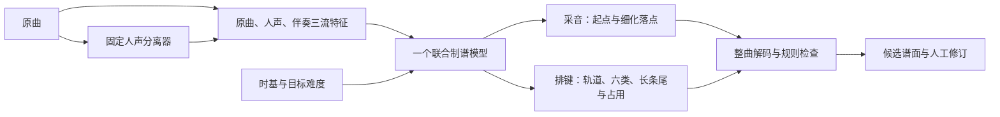

# 联合制谱模型与训练数据契约 v1

> 历史联合模型契约。2026-09-28起当前架构与训练策略以[17-双模型采音与排键训练契约](17-双模型采音与排键训练契约.md)为准。旧数据映射与实验身份保持不变；新模型不使用BPM、相位或节拍网格。

2026-09-27。本文为首版工程契约，原始候选范围8.5～10.5，含两端。本轮用户进一步授权监督训练，已完成独立实验基线、冻结参数后的锁定评价和试听材料；模型质量不合格，真人听评与真实游戏验收仍未完成。实际权重、命令与指标见16号交接及新实验报告，不以契约描述冒充质量通过。

## 1. 训练几个模型

**首版只有一个需要监督训练的联合制谱模型：joint-tcn-v1。采音和排键都学习，共享主干，使用多个输出。** 排键不完全依赖规则。

- 采音任务：决定物件起点、具体落点偏移和休息；难度作为连续条件输入。
- 排键任务：地面／空中、六类物件、长条结束和持续占用；通过同一网络联合预测。
- 规则层：生成候选的特重击排他、轨道占用、合法持续区间和冲突选择，保留拒绝原因。

已有MelBandRoformer只作冻结的离线分离器，BeatThis沿用现有节拍流程；本次不重新训练这两个模型。准备阶段为随机初始化前向检查；监督阶段已生成独立实验checkpoint，未自动装入生产模型。先后两组优化参数实验仍是同一种联合模型，不是采音／排键分别训练两套网络。

图中的整曲中心拼接、头尾配对、规则及实验预测导出已实现并完成本轮自动评价；生产工作台接入仍属于后续步骤。模型训练流程成功不表示其编排质量可用。

## 2. 输入

| 输入 | 已实现定义 |
|---|---|
| 音频流 | 原混音、人声、伴奏三流；分离器原生输出人声，伴奏为原混音减人声的float32残差 |
| 分离 | 作者MelBandRoformer固定权重87201f4d…；44.1kHz立体声，8秒分块、25%重叠、均匀归一化叠加；GPU bfloat16自动混合精度，STFT／输出保持float32路径，批量4块 |
| 特征 | 24kHz；FFT1024；周期Hann窗；hop240即10ms；96个Slaney mel频带，30～12000Hz；两声道功率平均 |
| 数值 | log1p(10000×mel功率)，缓存float16，加载为float32；不使用全数据集均值／方差，不按音轨单独增益归一化 |
| 时基／难度 | 四个输入：拍位置sin/cos、log2(BPM/120)、difficulty−9.5；来自明确的音频原点和当前时基 |
| 窗口 | 32秒，中心16秒监督，左右各8秒上下文；整曲先分配角色，再切窗；边缘补零不参与loss |

模型输入严格只有音频特征及时基／难度。原对象代码、谱名、作者、来源角色、事件ID等不作为网络输入。

分离后的float WAV允许超过[-1,1]的真实数值，保留峰值，不用整数剪裁伪造干净波形。工程检查包括完整样本覆盖、原点／长度、有限数值、写入重读与混音重建；这些不是人声分离质量的人工评价。配置与权重／环境／源音频身份写入缓存元信息。

## 3. 主干与输出

共享的音频流编码器将各流96维mel映射至64维，再融合三流、时基／难度和人声活动先验。主干为128通道、8个残差TCN块，卷积核5、扩张率1/2/4/8/16/32/64/128；参数总数826,078。它是离线双向上下文模型。

人声活动先验用分离流与混音的相对能量构造软权重，人声权重范围0.5～1、伴奏权重0.5～1，混音上下文保持。活动只调整参考偏好，不直接生成note；持续人声音量不会被硬编码成连续击打。社区谱没有逐note声部来源监督，不能宣称此偏好已经学会；Sol需在开发／验证片段上评价人声起音、长音、间奏和分离漏音行为。

| 输出 | 单批形状 | 监督含义 |
|---|---|---|
| onset_logits | B×3200×2×6 | 各轨各类的起点是否存在；sigmoid多标签，不能六选一argmax |
| offsets | B×3200×2×6 | 起点在10ms格内的位置，范围[0,1)；保留毫秒标签，避免直接吸到栅格 |
| hold_end_logits | B×3200×2 | 长条尾点存在性 |
| hold_end_offsets | B×3200×2 | 尾点在格内的位置 |
| occupancy_logits | B×3200×2 | 长条半开区间[start,end)占用 |

采音存在性、类别与轨道联合编码在起点矩阵中；Gemini同时监督两轨的Gemini位；双重击同时监督两轨heavy位；长条＋击打可在同一格分别为真。1ms点按长条允许头尾落在同一格，由独立头尾输出和偏移表达。

来源事件同轨同类落进同一10ms格而无法分别表达时，不取最后一个标签冒充完整监督；记录量化冲突并屏蔽该格的相应类别／偏移loss。原事件仍完整保留。当前219张可用谱共发现14个此类单元。

## 4. 排他、来源与冲突

沿用12/13文档的用户明确规则。为完成本次可逆工程准备，采用以下显式版本化默认值：特重击排他范围为同刻双轨，无额外前后留空；长条占用为[start,end)，因此长条结束与特重击起点同刻可相接。其余仍属13表建议的轻／重分界按该表实现。它们是本次授权内的工程选择，不伪称用户逐项另行确认。

源谱存在未知代码、缺尾、未核验的换轨弹幕、单边／歧义Gemini或硬冲突时，当前保守策略隔离整张谱，保存已经还原的事件和原因。普通连打源标记不是每一个都对应一次击打；先按同代码同通道配对，再生成起点双重击，单独存在的真实长条保留。只有完全相同代码／起止的跨轨连打对应物才合并来源，避免生成四个重击；同轨重复不盲目去重。

Ghost和暂排除道具不参与正样本；其位置前后各一格的对应轨道负监督屏蔽，但同格的合法事件正监督保留。Note按light训练。原始SourceChart／旁表和派生TrainingChart分开保存。

推理候选采用带分数的规则选择，拒绝项有可追溯原因；该选择器不能拿来悄悄删除来源谱的冲突标签。完整音频推理应拼接各窗口的中心输出，再解释长条头尾；不能在每个窗口边界强行截断长条。

### 4.1 用户再次明确的生成硬约束：同位置唯一，长按＋点击例外

2026-09-27用户强调：“一般情况下是禁止同一个位置出现两个note，除非是长按+点击类型，这点尤其重要”。该条作为当前生成规范，优先于首版宽松候选validator所接受的多类型叠加。

- 位置按**轨道＋落点**计算。相同轨道、相同落点最多一个瞬时物件，类别不同不能绕过规则；轻击＋重击、Gemini＋另一个点击等禁止。
- 唯一保留的同轨重叠形式是**一条长按＋一个点击**。不能借此允许长按＋两个点击，不能重叠两条长按。长条持续中的点击仍允许，结束点采用原半开区间约定。
- Gemini作为一个双轨逻辑物件同时占用地面、空中两个位置，必须完整保留或完整拒绝；禁止把被阻挡的一半切掉。双轨重击是两个heavy组成的完整组，不冒充Gemini，也不因冲突静默拆成单击。
- 同刻不同轨道的合法组合继续允许。特重击双轨排他规则优先，不能用长按＋点击例外绕开；齿轮不是点击，不允许和长按或其他物件同位置共存。
- 当前近重合判定沿用实验工程容差20ms，避免1ms输出偏移绕过互斥；这不是用户定义的拍数间隔，也不强制把音符吸到节拍网上。阈值自适应、空小节候选补选、后处理、编辑及出包都必须复用该占用约束，不能为增加数量而突破它。

独立实现 `generated_constraints.py`，policy=`generated-single-position-v2`；原训练标签／manifest／冻结v1解码器不修改。新曲推理在v1整曲配对结果后，恢复对应原始峰值分数，再按分数作完整物件／组的贪心候选选择；组分数取最弱成员，保留拒绝原因及分数，不移动时间、不改变类别、不截短长条。这是新推理策略，不得沿用旧冻结测试指标声称其效果已评估。旧v1候选池中已被拒绝的候选暂不重新召回，当前选择并不保证全局音乐最优。

生成、审计和出包共用新validator；旧来源标签的历史兼容检查仍独立，后续若要按新规则审计／重建监督目标必须另建准备版本，不能覆盖219张既有标签或悄悄改划分。训练张量允许多标签用于Hold＋点击，不表示推理可以把所有瞬时类别一起导出。

实际回归32项通过，覆盖同类／异类／齿轮叠加、1ms偏移、Gemini完整性、双重击完整性、长按＋一个点击、长条边界及BMS回读。在《琵琶行》冻结网络输出上，仅作新规则静态复核，444逻辑候选保留330个：70个同刻叠层位置和近邻叠层均归零，5个长条仍带合法点击；16段≥2秒空档仍在。未生成新游戏包，不能说整曲质量已修复。

## 5. 监督损失接口（首轮监督实验已完成）

已提供masked多标签BCE、起点偏移SmoothL1、尾点BCE／偏移及占用BCE的组合接口。初始组合为1×起点＋0.25×起点偏移＋0.5×尾点＋0.25×尾点偏移＋0.25×占用；这是可运行基线，不是经过验证的最优权重。

张量报告根据**训练角色有效mask**统计正负样本，并提供sqrt(负／正)、限制在[1,100]的pos_weight起始建议；验证／测试角色不参与权重计算。特重击训练参考只有206个，Sol必须单列召回和误报，不能用总体正确率掩盖稀有类别失败。类别权重与正样本权重是不同参数，不应混用。

首轮两组实验均使用以上训练角色权重及原损失组合。最终实验LR=0.0003，batch8，最多30轮，patience10；最佳验证loss0.26085230在第27轮。验证／锁定测试六类宏平均F1为0.15545／0.13585，特重击测试0/17召回、5次误报；这不是质量合格模型。阈值、评价容差、原始及配对长条指标、取消／恢复证据均写入新实验目录，原准备批次保持不变。

## 6. 六类表示与导出范围

新增TrainingEvent独立表达六类、真实击打轨道、起止、排他和来源，未改坏现有schema1/basic工作流。six_export提供实验BMS导出和回读，拒绝冲突及未经明确处理的亚毫秒时间。双轨长条在BMS中是两条物理长条，原逻辑分组和ID必须保留在TrainingChart旁表；Gemini仍保持成对语义。

这是训练前表示／验证接口和独立审阅页面，不是现有工作台已经完整接入六类编辑。生产工作台接线、Boss场景导出和真实游戏加载仍需之后验收；本次不宣称已通过实玩或自动替换生产profile。
